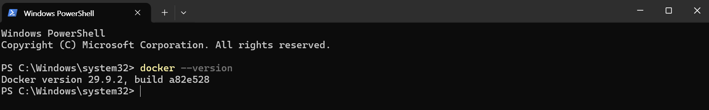
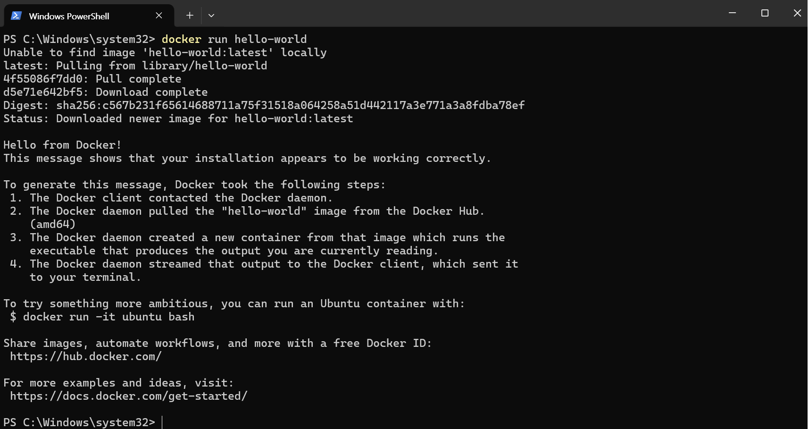

# Docker 개발 워크스테이션 구축

## ✅ 작업 체크리스트
- [x] Docker Desktop 설치
- [x] Docker 버전 확인
- [x] hello-world 실행 성공

## 🛠️ 사용 환경
- OS: Windows
- Docker Desktop

## 📸 실행 결과
### 1. Docker 버전 확인

### 2. hello-world 실행

## 🛠️ 트러블슈팅

### 트러블슈팅 1. Docker 가입 시 인증 메일이 오지 않음
- **문제:** GitHub 연동으로 Docker Desktop 가입 중, 인증 코드 입력 단계에서 인증 메일이 오지 않았다.
- **원인 가설:** GitHub 계정이 Apple ID로 가입돼 있어, 인증 메일이 iCloud 메일로 가는데 그 과정에 문제가 있다고 생각했다.
- **확인:** iCloud 메일을 새로고침하고 네이버·다음 메일까지 확인했지만 인증 메일이 없었다.
- **해결/대안:** 연동 가입 대신 Docker Desktop 자체 계정으로 직접 가입하여 해결했다. (원인 파악에 1시간 이상 소요)

### 트러블슈팅 2. GitHub에 올린 파일을 삭제하는 방법을 못 찾음
- **문제:** GitHub에 올린 파일을 삭제하려 했지만 삭제 메뉴를 찾지 못했다.
- **원인 가설:** 파일을 클릭하면 삭제 버튼이 바로 나올 것이라고 생각했다. 하지만 파일을 눌러도 초록색·빨간색 변경 표시만 보였다.
- **확인:** 파일 상세 화면에는 삭제 항목이 없고, 수정·삭제는 다른 화면에서 해야 한다는 것을 확인했다.
- **해결/대안:** 저장소 파일 목록에서 연필(수정) 아이콘을 누르면 내용을 수정·삭제할 수 있다는 것을 알고 해결했다.

### 트러블슈팅 3. 저장소(repository)를 삭제하는 방법을 못 찾음
- **문제:** 저장소 자체를 삭제하려 했지만 삭제 항목을 찾지 못했다.
- **원인 가설:** 사용자 메뉴의 Settings 안에 삭제 항목이 있을 것이라고 생각했다.
- **확인:** 사용자 Settings를 아무리 살펴봐도 삭제 항목(Danger Zone)이 없었다.
- **해결/대안:** 사용자 설정이 아니라 해당 저장소 안의 Settings를 열면 맨 아래 Danger Zone에서 저장소를 삭제할 수 있었다.
